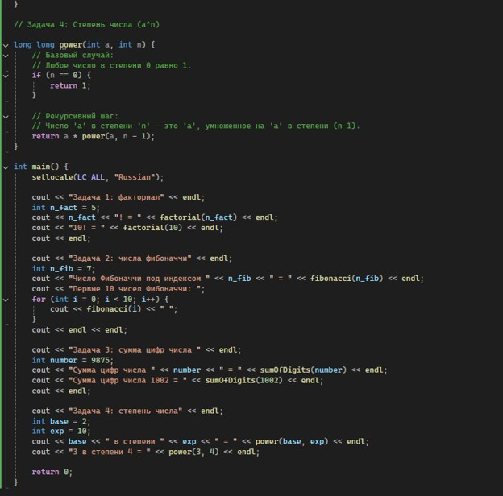
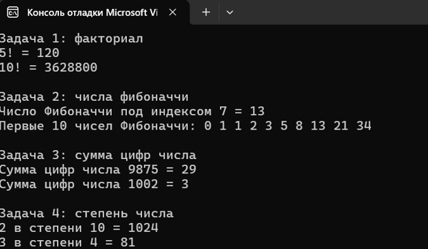
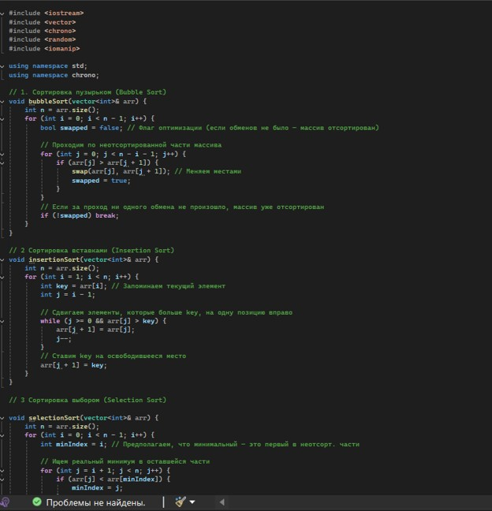
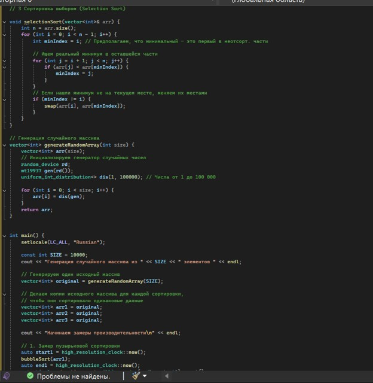
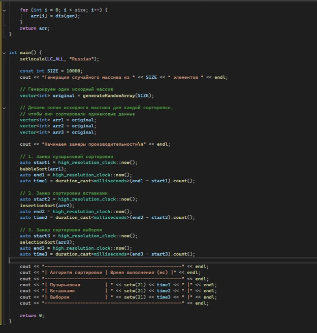
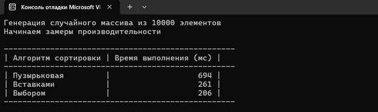

# Лабораторная работа №6
## Рекурсивные алгоритмы. Простые сортировки

**Выполнила:** *Агафонова Софья Сергеевна*  
**Группа:** *ПИЖ-б-о-25-1*  
**Вариант:** 1 
---

## Цель работы

Цель работы: 
1. Освоить принципы рекурсии: прямой и косвенной, базовый 
случай и шаг рекурсии 
2. Научиться применять рекурсию для решения практических задач 
(факториал, числа Фибоначчи, Ханойские башни, обход 
лабиринта) 
3. Реализовать и сравнить простые алгоритмы сортировки: 
пузырьковую, вставками, выбором 
4. Проанализировать сложность рекурсивных алгоритмов и простых 
сортировок 
5. Сравнить рекурсивную и итеративную реализации одних и тех же 
алгоритмов 
---
# Теоретическая часть

## 1. Рекурсия

### 1.1. Понятие рекурсии
**Рекурсия** — это метод в программировании, при котором функция вызывает саму себя для решения подзадачи, которая является частью исходной задачи. 

Любая рекурсивная функция должна содержать два обязательных компонента:
1. **Базовый случай (база рекурсии)** — условие, при котором функция прекращает вызывать саму себя и возвращает конкретный результат. Без базового случая рекурсия будет бесконечной и приведет к переполнению стека (Stack Overflow).
2. **Рекурсивный случай (шаг рекурсии)** — вызов функцией самой себя с измененными аргументами, которые приближают решение к базовому случаю.

### 1.2. Как работает рекурсия (Стек вызовов)
При вызове рекурсивной функции каждый новый вызов создает новый **кадр стека** (stack frame), в котором сохраняются локальные переменные, аргументы функции и адрес возврата. Эти кадры накапливаются в стеке вызовов (Call Stack) сверху вниз.

Когда срабатывает базовый случай, функция начинает возвращать значения, и кадры стека поочередно уничтожаются (сверху вниз). Это называется **раскруткой рекурсии**.

**Пример (Вычисление факториала):**
`n! = n * (n - 1)!`
*   Базовый случай: `0! = 1` или `1! = 1`.
*   Рекурсивный шаг: `n * factorial(n - 1)`.

### 1.3. Виды рекурсии
*   **Прямая рекурсия** — функция вызывает саму себя напрямую.
*   **Косвенная рекурсия** — функция A вызывает функцию B, а та, в свою очередь, вызывает функцию A.
*   **Хвостовая рекурсия** — рекурсивный вызов является последней операцией в функции (после него нет никаких вычислений). Некоторые компиляторы оптимизируют хвостовую рекурсию, превращая её в обычный цикл, что экономит память.

### 1.4. Преимущества и недостатки
**Преимущества:**
*   Код становится более коротким, элегантным и легко читаемым (особенно для задач, связанных с деревьями, графами и математическими последовательностями).
*   Упрощается решение задач, имеющих рекурсивную природу (обход дерева, алгоритмы «Разделяй и властвуй»).

**Недостатки:**
*   Требует больше памяти из-за накладных расходов на стек вызовов (каждый вызов сохраняет контекст).
*   Может привести к переполнению стека при большой глубине рекурсии.
*   Работает медленнее итеративного решения из-за затрат времени на вызовы функций.

---

## 2. Простые сортировки

**Сортировка** — это процесс упорядочивания элементов массива или списка по возрастанию или убыванию. *Простыми* (или квадратичными) называются сортировки, сложность которых в среднем и худшем случае составляет `O(n²)`. Они просты в реализации, но неэффективны на больших массивах данных. 

К простым сортировкам традиционно относят: сортировку пузырьком, сортировку вставками и сортировку выбором.

### 2.1. Сортировка пузырьком (Bubble Sort)
**Принцип:** Алгоритм многократно проходит по массиву, сравнивая соседние элементы. Если элементы стоят в неправильном порядке (например, текущий больше следующего при сортировке по возрастанию), они меняются местами. 

*   **Как работает:** Самый большой элемент «всплывает» (как пузырек) в конец массива за один полный проход. Следующий проход делается до предпоследнего элемента и т.д.
*   **Оптимизация:** Если за очередной проход не было сделано ни одного обмена, значит массив уже отсортирован, и алгоритм можно завершить досрочно (флаг `swapped`).
*   **Сложность:** 
    *   Лучший случай: `O(n)` (если массив уже отсортирован и добавлена оптимизация с флагом).
    *   Средний и худший случай: `O(n²)`.
*   **Свойства:** Устойчивая (не меняет порядок равных элементов). Много лишних обменов, из-за чего работает медленнее других простых сортировок.

### 2.2. Сортировка вставками (Insertion Sort)
**Принцип:** Массив мысленно делится на две части: отсортированную и неотсортированную. В начале отсортированная часть состоит из одного первого элемента. Алгоритм берет следующий элемент из неотсортированной части и вставляет его в нужное место в отсортированной части, сдвигая большие элементы вправо.

*   **Как работает:** Похоже на то, как мы раскладываем карты в руке, вставляя новую карту в нужное место.
*   **Сложность:**
    *   Лучший случай: `O(n)` (если массив уже отсортирован, каждый элемент встает на свое место за одно сравнение).
    *   Средний и худший случай: `O(n²)`.
*   **Свойства:** Устойчивая. Очень эффективна для массивов, которые уже почти отсортированы, или для небольших массивов.

### 2.3. Сортировка выбором (Selection Sort)
**Принцип:** Массив делится на две части: отсортированную (в начале) и неотсортированную (в конце). На каждом шаге алгоритм ищет минимальный элемент (или максимальный) в неотсортированной части и меняет его местами с первым элементом неотсортированной части.

*   **Как работает:** На первом проходе находим минимум и ставим его на первое место. На втором — находим минимум среди оставшихся и ставим на второе, и так далее.
*   **Сложность:**
    *   В любом случае: `O(n²)` (так как всегда нужно пройти по всему оставшемуся массиву для поиска минимума, независимо от изначального порядка).
*   **Свойства:** Неустойчивая (при обмене элементов может нарушиться порядок равных). Делает **наименьшее количество обменов** (всего `n-1` обмен), что полезно, если запись элементов в память — дорогая операция.

---

## 3. Сравнение простых сортировок

| Алгоритм | Лучший случай | Средний случай | Худший случай | Память | Устойчивость | Обмены |
| :--- | :--- | :--- | :--- | :--- | :--- | :--- |
| **Пузырьком** | `O(n)` | `O(n²)` | `O(n²)` | `O(1)` | Да | `O(n²)` |
| **Вставками** | `O(n)` | `O(n²)` | `O(n²)` | `O(1)` | Да | `O(n²)` |
| **Выбором** | `O(n²)` | `O(n²)` | `O(n²)` | `O(1)` | Нет | `O(n)` |

**Вывод:** 
Простые сортировки не используются для больших массивов данных (для этого есть быстрые алгоритмы вроде QuickSort или MergeSort, работающие за `O(n log n)`). Однако их полезно изучать, так как они наглядно демонстрируют базовые принципы работы алгоритмов. Кроме того, **сортировка вставками** часто используется на практике как вспомогательный алгоритм для небольших подмассивов внутри быстрых сортировок (например, в Timsort или IntroSort).

---

## 4. Связь рекурсии и сортировок

Хотя простые сортировки (пузырек, вставки, выбор) обычно реализуются итеративно (через циклы), рекурсию можно использовать и для них. 

Однако настоящая мощь рекурсии раскрывается в **продвинутых сортировках**, основанных на парадигме **«Разделяй и властвуй»** (Divide and Conquer):
*   **Быстрая сортировка (QuickSort):** Рекурсивно разбивает массив на подмассивы относительно опорного элемента.
*   **Сортировка слиянием (MergeSort):** Рекурсивно делит массив пополам, сортирует каждую половину и затем сливает их вместе.

Именно в этих алгоритмах рекурсия позволяет элегантно и эффективно обрабатывать массивы за время `O(n log n)`, что делает её незаменимым инструментом в арсенале программиста.

---
Вот только **Постановка задачи** по твоим двум скриншотам (Вариант 1).

---

## Постановка задачи

**Общее задание:** 
Освоить рекурсивный подход к решению задач и изучить алгоритмы простых сортировок. Реализовать соответствующие алгоритмы на языке C++.

**Индивидуальное задание (Вариант 1):**

### Часть 1. Рекурсивные алгоритмы
Реализовать 4 рекурсивные функции:

| № | Задание |
| :--- | :--- |
| **1** | Факториал числа (`n!`) |
| **2** | Числа Фибоначчи (`F(n)`) |
| **3** | Сумма цифр числа |
| **4** | Степень числа (`a^n`) |

### Часть 2. Простые сортировки
| Сортировки для реализации | Дополнительное задание |
| :--- | :--- |
| Пузырьковая, вставками, выбором | Сравнить производительность на случайном массиве |

### Требования к реализации:
1. **Для рекурсивных алгоритмов:** Написать отдельные функции, которые принимают нужные аргументы (например, `n`, `a`) и возвращают результат. Обязательно предусмотреть базовые случаи для предотвращения бесконечной рекурсии.
2. **Для сортировок:** Реализовать три функции сортировки (Bubble Sort, Insertion Sort, Selection Sort), которые принимают вектор (или массив) по ссылке и сортируют его.
3. **Сравнение производительности:** Написать демонстрационную программу, которая генерирует случайный массив большого размера (например, 10 000 или 50 000 элементов) и замеряет время работы каждой из трех сортировок (например, с помощью `std::chrono`).
---

## Индивидуальное задание

*Рисунок 1- Код программы*

*Рисунок 2- Код программы*

*Рисунок 3- Код программы*

*Рисунок 4- Код программы*

*Рисунок 5- Код программы*

*Рисунок 6 - Код программы*

*Рисунок 7- Код программы*

*Рисунок 8- Код программы*

*Рисунок 9- Код программы*

*Рисунок 10- Код программы*
## Результаты работы программы

*Рисунок 11- Результат программы*

## Ответы на контрольные вопросы

**1. В чём заключается принцип работы стека (LIFO)?**
Стек работает по принципу **LIFO** (Last In — First Out, «последним пришёл — первым ушёл»). Это означает, что элемент, который был добавлен в стек последним, будет извлечён из него первым. Добавление (`push`) и удаление (`pop`) происходят только с одного конца, который называется вершиной стека. 

**2. В чём заключается принцип работы очереди (FIFO)?**
Очередь работает по принципу **FIFO** (First In — First Out, «первым пришёл — первым ушёл»). Элемент, добавленный в очередь первым, будет извлечён из неё первым. Добавление новых элементов (`enqueue`) происходит строго в конец очереди (хвост), а извлечение (`dequeue`) — строго из начала (голова).

**3. Чем дек отличается от обычной очереди?**
Обычная очередь позволяет добавлять элементы только в конец, а удалять только из начала (или наоборот, в зависимости от реализации, но доступ всегда односторонний для каждой операции). **Дек** (двусторонняя очередь) позволяет добавлять и удалять элементы **с обоих концов** (`push_front`, `push_back`, `pop_front`, `pop_back`). Дек можно использовать и как стек, и как обычную очередь.

**4. Что такое приоритетная очередь? Где она применяется?**
Приоритетная очередь — это структура данных, в которой каждый элемент имеет определенный приоритет. Извлечение элементов происходит не по времени их добавления, а по их приоритету (первыми извлекаются элементы с наивысшим приоритетом). 
**Применяется:** в планировщиках задач операционных систем, в алгоритмах на графах (алгоритм Дейкстры для поиска кратчайшего пути, алгоритм Прима), в симуляциях событий, а также для поиска K наибольших/наименьших элементов.

**5. Как реализовать стек на основе динамического массива?**
Создается массив (выделяется память под определенную емкость `capacity`) и заводится переменная `topIndex` (индекс вершины), изначально равная `-1`. 
*   При добавлении (`push`): если массив полон, его емкость увеличивается (обычно в 2 раза) с копированием старых элементов. Затем `topIndex` увеличивается на 1, и в `data[topIndex]` записывается значение.
*   При удалении (`pop`): значение берется из `data[topIndex]`, а `topIndex` уменьшается на 1.

**6. Как реализовать очередь на основе кольцевого буфера?**
Выделяется массив фиксированной или динамической емкости. Заводятся два индекса: `front` (начало) и `rear` (конец), а также счетчик элементов `count`. 
*   При добавлении (`enqueue`): элемент пишется в `data[rear]`, после чего индекс `rear` сдвигается по кругу: `rear = (rear + 1) % capacity`.
*   При удалении (`dequeue`): значение берется из `data[front]`, индекс `front` сдвигается по кругу: `front = (front + 1) % capacity`. 
Использование операции взятия остатка (`% capacity`) позволяет индексам «зацикливаться» и повторно использовать освободившееся в начале массива место без сдвига элементов.

**7. Почему приоритетную очередь обычно реализуют на куче?**
Двоичная куча (binary heap) обеспечивает оптимальный баланс между скоростью основных операций. Вставка (`push`) и извлечение максимума/минимума (`pop`) выполняются за `O(log n)`, а доступ к максимальному/минимальному элементу (`top`) — за `O(1)`. При этом куча эффективно использует память (реализуется на массиве без указателей), в отличие от сбалансированных деревьев поиска. Использование обычного массива дало бы `O(n)` на извлечение, а сортированного массива — `O(n)` на вставку.

**8. Какова сложность операций push и pop в стеке?**
Сложность обеих операций — **`O(1)`** (константное время). При реализации на динамическом массиве сложность `push` является амортизированной `O(1)`, так как операция расширения массива (удвоение) происходит лишь периодически.

**9. Какова сложность операций enqueue и dequeue в очереди?**
Сложность обеих операций — **`O(1)`**. В кольцевом буфере операции сводятся к записи/чтению по индексу и изменению индексов по модулю. При расширении динамического кольцевого буфера сложность `enqueue` становится амортизированной `O(1)`.

**10. Какова сложность операций в приоритетной очереди? Почему?**
*   `push` (вставка) — **`O(log n)`**.
*   `pop` (извлечение) — **`O(log n)`**.
*   `top` (просмотр) — **`O(1)`**.
*Почему:* В двоичной куче при вставке новый элемент добавляется в конец, а затем «всплывает» (просеивается) вверх до своего места. Высота кучи равна `log n`, поэтому в худшем случае совершается `log n` обменов. При извлечении корень удаляется, на его место ставится последний элемент, который затем «погружается» вниз, что также требует `O(log n)` времени.

**11. Как проверить правильность расстановки скобок с помощью стека?**
Нужно итерироваться по строке. Если встречается открывающая скобка (`(`, `[`, `{`), она помещается в стек. Если встречается закрывающая скобка, то проверяется: 
1. Не пуст ли стек (иначе скобка лишняя). 
2. Соответствует ли верхняя скобка в стеке текущей закрывающей. Если нет — ошибка. Если да — скобка извлекается из стека. 
В конце работы цикла стек должен быть пуст (все скобки закрыты).

**12. Как реализовать очередь на двух стеках? Какова сложность?**
Используются два стека: `in` (для добавления) и `out` (для извлечения). 
*   `enqueue`: элемент всегда кладется в стек `in`.
*   `dequeue`: если стек `out` пуст, все элементы из стека `in` перекладываются в стек `out` (при этом их порядок меняется на обратный). Затем элемент извлекается из `out`.
*Сложность:* Операция `enqueue` — строго `O(1)`. Операция `dequeue` в худшем случае занимает `O(n)` (когда нужно перекладывать элементы), но **амортизированная сложность** составляет `O(1)`, так как каждый элемент перекладывается из `in` в `out` не более одного раза за всё время работы.

**13. Как реализовать дек на основе двусвязного списка?**
Создаются указатели на начало (`head`) и конец (`tail`) списка. 
*   `push_front`: новый узел создается и вставляется перед `head`, указатель `head` обновляется. 
*   `push_back`: новый узел вставляется после `tail`, указатель `tail` обновляется. 
*   `pop_front` / `pop_back`: удаляется соответствующий крайний узел, память освобождается, а `head` / `tail` сдвигаются на следующий / предыдущий узел. Все операции происходят за `O(1)`, так как не требуют перебора элементов.

**14. Как реализовать дек на основе кольцевого буфера?**
Это похоже на реализацию обычной очереди, но с возможностью движения в обе стороны. Заводятся индексы `front` и `rear`. 
*   `push_front`: `front` сдвигается назад по кругу (`front = (front - 1 + capacity) % capacity`), элемент записывается в `data[front]`.
*   `push_back`: элемент записывается в `data[rear]`, `rear` сдвигается вперед (`rear = (rear + 1) % capacity`).
*   `pop_front` и `pop_back` аналогично сдвигают соответствующие индексы навстречу друг другу.

**15. Как реализовать стек с поддержкой получения минимума за O(1)?**
Нужно использовать **два стека**: основной `mainStack` для хранения всех элементов и вспомогательный `minStack` для хранения минимумов.
*   `push(x)`: кладем `x` в `mainStack`. Если `minStack` пуст или `x <= minStack.top()`, кладем `x` в `minStack`. (Если `x` больше текущего минимума, мы не добавляем его в `minStack`).
*   `pop()`: извлекаем элемент из `mainStack`. Если он равен `minStack.top()`, то извлекаем и из `minStack`.
*   `getMin()`: просто возвращаем `minStack.top()`, что занимает `O(1)`.
*(При таком подходе дополнительный стек занимает `O(n)` памяти в худшем случае, но все операции выполняются за `O(1)`).*
---

## Выводы

В ходе выполнения лабораторной работы я:
1. Реализовала основные линейные структуры данных: стек, 
очередь, дек и приоритетную очередь 
2. Освоила принципы LIFO (стек) и FIFO (очередь) 
3. Научилась реализовывать эти структуры на основе 
динамического массива и связного списка 
4. Изучила применение стека для решения задач (проверка скобок, 
обратная польская запись) 
5. Реализовала приоритетную очередь на основе кучи (heap) 
---

**Ссылка на Git-репозиторий с кодом программы:**  
https://github.com/agafonovasofa631-collab/5.git
