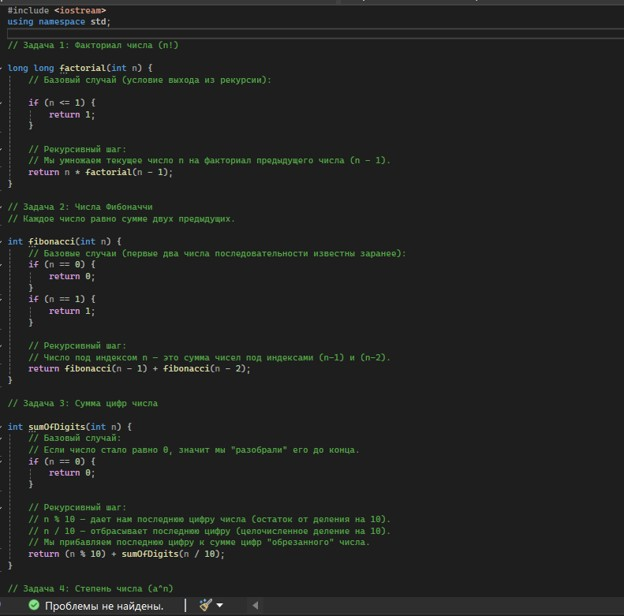

# Лабораторная работа №6
## Рекурсивные алгоритмы. Простые сортировки

**Выполнила:** *Агафонова Софья Сергеевна*  
**Группа:** *ПИЖ-б-о-25-1*  
**Вариант:** 1 
---

## Цель работы

Цель работы: 
1. Освоить принципы рекурсии: прямой и косвенной, базовый 
случай и шаг рекурсии 
2. Научиться применять рекурсию для решения практических задач 
(факториал, числа Фибоначчи, Ханойские башни, обход 
лабиринта) 
3. Реализовать и сравнить простые алгоритмы сортировки: 
пузырьковую, вставками, выбором 
4. Проанализировать сложность рекурсивных алгоритмов и простых 
сортировок 
5. Сравнить рекурсивную и итеративную реализации одних и тех же 
алгоритмов 
---
# Теоретическая часть

## 1. Рекурсия

### 1.1. Понятие рекурсии
**Рекурсия** — это метод в программировании, при котором функция вызывает саму себя для решения подзадачи, которая является частью исходной задачи. 

Любая рекурсивная функция должна содержать два обязательных компонента:
1. **Базовый случай (база рекурсии)** — условие, при котором функция прекращает вызывать саму себя и возвращает конкретный результат. Без базового случая рекурсия будет бесконечной и приведет к переполнению стека (Stack Overflow).
2. **Рекурсивный случай (шаг рекурсии)** — вызов функцией самой себя с измененными аргументами, которые приближают решение к базовому случаю.

### 1.2. Как работает рекурсия (Стек вызовов)
При вызове рекурсивной функции каждый новый вызов создает новый **кадр стека** (stack frame), в котором сохраняются локальные переменные, аргументы функции и адрес возврата. Эти кадры накапливаются в стеке вызовов (Call Stack) сверху вниз.

Когда срабатывает базовый случай, функция начинает возвращать значения, и кадры стека поочередно уничтожаются (сверху вниз). Это называется **раскруткой рекурсии**.

**Пример (Вычисление факториала):**
`n! = n * (n - 1)!`
*   Базовый случай: `0! = 1` или `1! = 1`.
*   Рекурсивный шаг: `n * factorial(n - 1)`.

### 1.3. Виды рекурсии
*   **Прямая рекурсия** — функция вызывает саму себя напрямую.
*   **Косвенная рекурсия** — функция A вызывает функцию B, а та, в свою очередь, вызывает функцию A.
*   **Хвостовая рекурсия** — рекурсивный вызов является последней операцией в функции (после него нет никаких вычислений). Некоторые компиляторы оптимизируют хвостовую рекурсию, превращая её в обычный цикл, что экономит память.

### 1.4. Преимущества и недостатки
**Преимущества:**
*   Код становится более коротким, элегантным и легко читаемым (особенно для задач, связанных с деревьями, графами и математическими последовательностями).
*   Упрощается решение задач, имеющих рекурсивную природу (обход дерева, алгоритмы «Разделяй и властвуй»).

**Недостатки:**
*   Требует больше памяти из-за накладных расходов на стек вызовов (каждый вызов сохраняет контекст).
*   Может привести к переполнению стека при большой глубине рекурсии.
*   Работает медленнее итеративного решения из-за затрат времени на вызовы функций.

---

## 2. Простые сортировки

**Сортировка** — это процесс упорядочивания элементов массива или списка по возрастанию или убыванию. *Простыми* (или квадратичными) называются сортировки, сложность которых в среднем и худшем случае составляет `O(n²)`. Они просты в реализации, но неэффективны на больших массивах данных. 

К простым сортировкам традиционно относят: сортировку пузырьком, сортировку вставками и сортировку выбором.

### 2.1. Сортировка пузырьком (Bubble Sort)
**Принцип:** Алгоритм многократно проходит по массиву, сравнивая соседние элементы. Если элементы стоят в неправильном порядке (например, текущий больше следующего при сортировке по возрастанию), они меняются местами. 

*   **Как работает:** Самый большой элемент «всплывает» (как пузырек) в конец массива за один полный проход. Следующий проход делается до предпоследнего элемента и т.д.
*   **Оптимизация:** Если за очередной проход не было сделано ни одного обмена, значит массив уже отсортирован, и алгоритм можно завершить досрочно (флаг `swapped`).
*   **Сложность:** 
    *   Лучший случай: `O(n)` (если массив уже отсортирован и добавлена оптимизация с флагом).
    *   Средний и худший случай: `O(n²)`.
*   **Свойства:** Устойчивая (не меняет порядок равных элементов). Много лишних обменов, из-за чего работает медленнее других простых сортировок.

### 2.2. Сортировка вставками (Insertion Sort)
**Принцип:** Массив мысленно делится на две части: отсортированную и неотсортированную. В начале отсортированная часть состоит из одного первого элемента. Алгоритм берет следующий элемент из неотсортированной части и вставляет его в нужное место в отсортированной части, сдвигая большие элементы вправо.

*   **Как работает:** Похоже на то, как мы раскладываем карты в руке, вставляя новую карту в нужное место.
*   **Сложность:**
    *   Лучший случай: `O(n)` (если массив уже отсортирован, каждый элемент встает на свое место за одно сравнение).
    *   Средний и худший случай: `O(n²)`.
*   **Свойства:** Устойчивая. Очень эффективна для массивов, которые уже почти отсортированы, или для небольших массивов.

### 2.3. Сортировка выбором (Selection Sort)
**Принцип:** Массив делится на две части: отсортированную (в начале) и неотсортированную (в конце). На каждом шаге алгоритм ищет минимальный элемент (или максимальный) в неотсортированной части и меняет его местами с первым элементом неотсортированной части.

*   **Как работает:** На первом проходе находим минимум и ставим его на первое место. На втором — находим минимум среди оставшихся и ставим на второе, и так далее.
*   **Сложность:**
    *   В любом случае: `O(n²)` (так как всегда нужно пройти по всему оставшемуся массиву для поиска минимума, независимо от изначального порядка).
*   **Свойства:** Неустойчивая (при обмене элементов может нарушиться порядок равных). Делает **наименьшее количество обменов** (всего `n-1` обмен), что полезно, если запись элементов в память — дорогая операция.

---

## 3. Сравнение простых сортировок

| Алгоритм | Лучший случай | Средний случай | Худший случай | Память | Устойчивость | Обмены |
| :--- | :--- | :--- | :--- | :--- | :--- | :--- |
| **Пузырьком** | `O(n)` | `O(n²)` | `O(n²)` | `O(1)` | Да | `O(n²)` |
| **Вставками** | `O(n)` | `O(n²)` | `O(n²)` | `O(1)` | Да | `O(n²)` |
| **Выбором** | `O(n²)` | `O(n²)` | `O(n²)` | `O(1)` | Нет | `O(n)` |

**Вывод:** 
Простые сортировки не используются для больших массивов данных (для этого есть быстрые алгоритмы вроде QuickSort или MergeSort, работающие за `O(n log n)`). Однако их полезно изучать, так как они наглядно демонстрируют базовые принципы работы алгоритмов. Кроме того, **сортировка вставками** часто используется на практике как вспомогательный алгоритм для небольших подмассивов внутри быстрых сортировок (например, в Timsort или IntroSort).

---

## 4. Связь рекурсии и сортировок

Хотя простые сортировки (пузырек, вставки, выбор) обычно реализуются итеративно (через циклы), рекурсию можно использовать и для них. 

Однако настоящая мощь рекурсии раскрывается в **продвинутых сортировках**, основанных на парадигме **«Разделяй и властвуй»** (Divide and Conquer):
*   **Быстрая сортировка (QuickSort):** Рекурсивно разбивает массив на подмассивы относительно опорного элемента.
*   **Сортировка слиянием (MergeSort):** Рекурсивно делит массив пополам, сортирует каждую половину и затем сливает их вместе.

Именно в этих алгоритмах рекурсия позволяет элегантно и эффективно обрабатывать массивы за время `O(n log n)`, что делает её незаменимым инструментом в арсенале программиста.

---
## Постановка задачи

**Общее задание:** 
Освоить рекурсивный подход к решению задач и изучить алгоритмы простых сортировок. Реализовать соответствующие алгоритмы на языке C++.

**Индивидуальное задание (Вариант 1):**

### Часть 1. Рекурсивные алгоритмы
Реализовать 4 рекурсивные функции:

| № | Задание |
| :--- | :--- |
| **1** | Факториал числа (`n!`) |
| **2** | Числа Фибоначчи (`F(n)`) |
| **3** | Сумма цифр числа |
| **4** | Степень числа (`a^n`) |

### Часть 2. Простые сортировки
| Сортировки для реализации | Дополнительное задание |
| :--- | :--- |
| Пузырьковая, вставками, выбором | Сравнить производительность на случайном массиве |

### Требования к реализации:
1. **Для рекурсивных алгоритмов:** Написать отдельные функции, которые принимают нужные аргументы (например, `n`, `a`) и возвращают результат. Обязательно предусмотреть базовые случаи для предотвращения бесконечной рекурсии.
2. **Для сортировок:** Реализовать три функции сортировки (Bubble Sort, Insertion Sort, Selection Sort), которые принимают вектор (или массив) по ссылке и сортируют его.
3. **Сравнение производительности:** Написать демонстрационную программу, которая генерирует случайный массив большого размера (например, 10 000 или 50 000 элементов) и замеряет время работы каждой из трех сортировок (например, с помощью `std::chrono`).
---

## Индивидуальное задание
# Часть 1

*Рисунок 1- Код программы*

*Рисунок 2- Код программы*

## Результаты работы программы

*Рисунок 3- Результат программы*

# Часть 2

*Рисунок 4- Код программы*

*Рисунок 5- Код программы*

*Рисунок 6 - Код программы*

## Результаты работы программы

*Рисунок 7- Результат программы*

---

## Ответы на контрольные вопросы

**1. Что такое рекурсия? Из каких компонентов состоит рекурсивная функция?**
**Рекурсия** — это метод программирования, при котором функция вызывает саму себя для решения более мелких подзадач. 
Рекурсивная функция обязательно состоит из двух компонентов:
1. **Базовый случай (база рекурсии)** — условие, при котором функция прекращает вызывать себя и возвращает конкретное значение.
2. **Рекурсивный шаг** — вызов функцией самой себя с измененными аргументами, приближающими решение к базовому случаю.

**2. Что такое базовый случай рекурсии? Почему он важен?**
**Базовый случай** — это условие выхода из рекурсии (например, `if (n == 0) return 1;`). Он важен потому, что предотвращает бесконечный вызов функции. Без базового случая рекурсия будет бесконечно добавлять новые кадры в стек вызовов, что приведет к переполнению стека (Stack Overflow) и аварийному завершению программы.

**3. Чем отличается прямая рекурсия от косвенной?**
*   **Прямая рекурсия:** функция вызывает саму себя напрямую из своего тела (например, `factorial(n)` вызывает `factorial(n-1)`).
*   **Косвенная рекурсия:** функция вызывает другую функцию, которая в итоге снова вызывает первую (например, функция `A` вызывает `B`, а `B` вызывает `A`).

**4. Что такое хвостовая рекурсия? В чём её преимущество?**
**Хвостовая рекурсия** — это частный случай рекурсии, при котором рекурсивный вызов является **последней операцией** в функции (после него нет никаких вычислений, сложения, умножения и т.д.). 
*Преимущество:* Умные компиляторы умеют оптимизировать хвостовую рекурсию, превращая её в обычный цикл (итерацию). Это экономит память, так как не создаются новые кадры стека, и предотвращает переполнение.

**5. Какова временная сложность рекурсивного вычисления чисел Фибоначчи? Почему?**
Сложность **наивного** рекурсивного вычисления чисел Фибоначчи — **`O(2^n)`** (экспоненциальная). 
*Почему:* Функция `F(n)` вызывает `F(n-1)` и `F(n-2)`. Дерево вызовов сильно ветвится. Одни и те же значения вычисляются множество раз. Например, при вычислении `F(5)`, значение `F(2)` будет вычислено несколько раз независимо друг от друга.

**6. Как можно оптимизировать рекурсивное вычисление Фибоначчи?**
Есть два основных способа:
1.  **Мемоизация (кэширование):** Сохранять уже вычисленные значения в массиве или хеш-таблице. Если значение уже есть в памяти, оно просто берется оттуда. Это снижает сложность до `O(n)`.
2.  **Итеративный подход:** Использовать цикл и хранить только два предыдущих значения (`a` и `b`), обновляя их на каждом шаге. Это дает сложность `O(n)` по времени и `O(1)` по памяти.

**7. В чём отличие рекурсивной реализации от итеративной?**
*   **Рекурсивная** реализация делает код более коротким, элегантным и понятным (особенно для задач вроде обхода деревьев). Но она требует больше памяти (из-за стека вызовов) и работает медленнее из-за накладных расходов на вызовы функций. Есть риск переполнения стека.
*   **Итеративная** реализация (циклы) работает быстрее, использует меньше памяти (`O(1)`) и не имеет ограничений по глубине. Но код может быть более громоздким и сложным для понимания.

**8. Какова сложность пузырьковой сортировки? Когда она становится O(n)?**
*   Сложность в среднем и худшем случае: **`O(n²)`**.
*   Сложность становится **`O(n)`** в лучшем случае, если массив уже отсортирован. Но это работает только при наличии **оптимизации флагом** (если за проход не было ни одного обмена, значит массив отсортирован, и цикл прерывается).

**9. Чем сортировка вставками отличается от сортировки выбором?**
*   **Сортировка вставками** берет следующий элемент и вставляет его в нужное место в уже отсортированной части, сдвигая элементы вправо. (Как раскладывание карт в руке).
*   **Сортировка выбором** на каждом шаге ищет минимальный (или максимальный) элемент во всем неотсортированном куске и меняет его местами с первым элементом этого куска. 
Вставки эффективнее на почти отсортированных данных, а выбором делает меньше всего перестановок (обменов).

**10. Какая из простых сортировок является устойчивой? Что это значит?**
**Устойчивыми** являются сортировка пузырьком и сортировка вставками. (Сортировка выбором — неустойчивая).
**Устойчивость** означает, что если в массиве есть два одинаковых элемента, то после сортировки они сохранят свой первоначальный относительный порядок (тот, что стоял левее, так и останется левее).

**11. Какая из простых сортировок работает лучше на почти отсортированных данных?**
**Сортировка вставками**. Если данные уже почти отсортированы, каждый новый элемент приходится сдвигать всего на пару позиций или не сдвигать вообще. Её сложность в этом случае приближается к `O(n)`. Пузырьковая с оптимизацией тоже справится за `O(n)`, но сделает это за счет меньшего количества лишних действий. Сортировка выбором всегда сделает `O(n²)` сравнений, независимо от того, отсортирован массив или нет.

**12. Как реализовать пузырьковую сортировку с оптимизацией?**
Нужно ввести логическую переменную-флаг (например, `swapped`), которая сбрасывается в `false` перед каждым проходом внешнего цикла. Если во время внутреннего цикла произошел обмен элементов, флаг становится `true`. Если после завершения внутреннего цикла флаг остался `false`, значит обменов не было, массив отсортирован, и внешний цикл прерывается через `break`.

**13. Что такое рекурсивный поиск с возвратом (backtracking)?**
**Backtracking** — это алгоритмическая техника, при которой решение ищется шаг за шагом. Если на очередном шаге выясняется, что текущий путь не ведет к решению (тупик), алгоритм отменяет последний шаг («возвращается» назад) и пробует другой вариант. Это часто реализуется рекурсивно. Примеры: решение судоку, задача о N-ферзях, поиск выхода из лабиринта.

**14. Как рекурсивно обойти лабиринт?**
Алгоритм похож на поиск в глубину (DFS):
1.  Отмечаем текущую клетку как посещенную.
2.  Если текущая клетка — выход, возвращаем `true` (успех).
3.  Для каждой соседней клетки (вверх, вниз, влево, вправо), если она не стена и не посещена, рекурсивно вызываем функцию обхода.
4.  Если один из вызовов вернул `true`, значит путь найден, возвращаем `true`.
5.  Если все соседи проверены и ни один не привел к выходу, возвращаем `false` (тупик), тем самым «откатываясь» назад.

**15. Какова сложность Ханойских башен? Сколько ходов нужно для перемещения n дисков?**
Количество ходов вычисляется по формуле **`2^n - 1`**. 
Следовательно, временная сложность алгоритма — **`O(2^n)`** (экспоненциальная). Каждый раз, увеличивая количество дисков на 1, мы удваиваем количество необходимых ходов плюс один.
---

## Выводы

В ходе выполнения лабораторной работы я:
1. Освоила принципы рекурсии: прямой и косвенной, базовый 
случай и шаг рекурсии 
2. Научилась применять рекурсию для решения практических задач 
(факториал, числа Фибоначчи, Ханойские башни, обход 
лабиринта) 
3. Реализовала и сравнила простые алгоритмы сортировки: 
пузырьковую, вставками, выбором 
4. Проанализировала сложность рекурсивных алгоритмов и простых 
сортировок 
5. Сравнила рекурсивную и итеративную реализации одних и тех же 
алгоритмов 
---

**Ссылка на Git-репозиторий с кодом программы:**  
https://github.com/agafonovasofa631-collab/6.git
